<p align="center">
  
</p>

<p align="center">


</p>

# 🌉 Ponte IA

> **Claude e ChatGPT na mesma conversa.** Um lê e critica a resposta do outro, e você decide o próximo passo.

Criado por **[Lucas Barkoski](https://github.com/Barkoski)**.

**Explore:** [⚡ Primeiro uso](#primeiro-uso) · [📌 Modos](#modos) · [🔑 Chaves de API](#chaves) · [🔒 Privacidade](#privacidade) · [🚧 Limitações](#limitacoes) · [🛠️ Para desenvolvedores](#desenvolvedores)

<p align="center">
  
</p>

## 🌉 O que é

O Ponte IA é um aplicativo para Windows que manda a mesma pergunta ao **Claude** (Anthropic) e ao **ChatGPT** (modelos GPT da OpenAI), mostra as duas respostas e, com um clique, faz cada um **ler e criticar** a resposta do outro. Acaba o vaivém de copiar e colar entre duas janelas.

**Para quem é:** quem já usa as duas IAs e quer comparar respostas em perguntas difíceis, sem confiar em um único ponto de vista.

O app conversa com as duas empresas pela API delas. Por isso você precisa das suas próprias chaves de API, que são cobradas por uso (veja [Chaves de API](#chaves)).

<a id="primeiro-uso"></a>
## ⚡ Primeiro uso

1. Abra a página de [Releases](https://github.com/Barkoski/ponte-ia/releases) e baixe uma das opções:
   - **Ponte IA - instalador.exe** (instala no computador), ou
   - **Ponte IA (portatil).exe** (roda sem instalar).
2. Abra o app. Na primeira vez, a tela de **Configurações** abre sozinha. Cole as chaves de API (atalho para voltar a ela: `Ctrl+,`).
3. Escolha o modo no topo da janela, escreva a pergunta e envie (`Ctrl+Enter`).

Para começar, teste com um assunto público:

```text
Compare as opções que descrevi. Separe fatos e hipóteses. Depois,
critique a resposta do outro modelo e diga o que você mantém ou revisa.
```

Os executáveis ainda **não têm assinatura de código**, então o Windows pode mostrar um aviso do SmartScreen. Para conferir se o download está íntegro, use o arquivo `SHA256SUMS.txt` publicado junto.

<a id="modos"></a>
## 📌 Modos de conversa

| Modo | O que acontece |
|---|---|
| **Paralelo** | A pergunta vai aos dois ao mesmo tempo. Nenhum vê a resposta do outro. |
| **Debate** | Claude responde → ChatGPT lê, critica e dá a versão dele → Claude responde à crítica, ponto a ponto. |
| **Consenso** | Os dois respondem em paralelo. Depois, um deles (você escolhe qual, em "Síntese por") faz a síntese: onde concordam, onde divergem e a resposta final. |
| **Só Claude** / **Só ChatGPT** | Apenas um dos dois responde. |

Depois de cada rodada, aparece uma barra com os próximos passos possíveis:

```
e agora:  [⇄ cada um analisa o outro]  [→ Claude analisa]  [→ ChatGPT analisa]  [⚖ síntese]
```

Nada dispara sozinho. Você lê as respostas e decide.

A análise cruzada é feita para ser crítica: cada modelo diz onde o outro acertou, onde errou ou omitiu, onde discorda (com fundamento) e o que revisa na própria resposta. Se o outro afirmou algo que não dá para verificar, deve marcar como não verificado, em vez de concordar por educação.

**Outros recursos:** anexar imagens e PDFs (vão aos dois modelos), definir uma instrução comum aos dois nas Configurações, exportar a conversa em Markdown (`Ctrl+E`) e começar uma nova conversa (`Ctrl+N`).

<a id="chaves"></a>
## 🔑 Chaves de API

- **Anthropic (Claude):** [console.anthropic.com](https://console.anthropic.com) → API Keys
- **OpenAI (ChatGPT):** [platform.openai.com](https://platform.openai.com) → API keys

Para os modos com os dois modelos, você precisa das duas chaves. Com uma só, funciona apenas o modo "Só" daquele modelo.

As APIs são cobradas por uso, e o app não inclui créditos. Assinaturas do Claude.ai e do ChatGPT Plus **não servem**: são produtos separados e não dão acesso à API.

A lista de modelos não é fixa. O app consulta cada empresa e mostra os modelos que a sua conta libera.

<a id="privacidade"></a>
## 🔒 Privacidade e segurança

- **O que sai do seu computador:** mensagens e anexos vão só para a empresa (ou as empresas) do modo escolhido. Nas chamadas à OpenAI, o app pede para a resposta não ser armazenada (`store: false`).
- **O que fica com as empresas:** Anthropic e OpenAI ainda aplicam as próprias regras de retenção e monitoramento. **Não envie dados sigilosos sem avaliar essas regras.**
- **Chaves:** ficam gravadas com a criptografia do Windows (`safeStorage`) e só a sua conta de usuário consegue lê-las. Se essa proteção não estiver disponível, o app se recusa a gravar a chave. Depois de salva, a chave não volta para a tela.
- **Conversa:** fica no seu computador, na pasta de dados do app dentro do seu perfil do Windows (`%APPDATA%`). Dá para desligar o salvamento entre sessões nas Configurações. O botão **Apagar chaves e dados** remove chaves, configurações e histórico.
- **Proteções da janela:** a interface roda isolada (sandbox), sem acesso ao Node nem a arquivos, com validação das mensagens internas e uma política de conteúdo que bloqueia scripts e estilos embutidos.

Para relatar uma falha de segurança, veja [SECURITY.md](SECURITY.md).

<a id="limitacoes"></a>
## 🚧 Limitações conhecidas

- **Só Windows x64.** Nada no código impede macOS ou Linux, mas não foi testado nem empacotado para eles.
- **Concordância não é prova.** Os dois modelos podem errar juntos. Confira o que for importante.
- **Anexos:** até 5 por mensagem, 20 MB por arquivo e 40 MB no total. Se o modelo escolhido aceita o arquivo, depende dele e dos limites da sua conta.
- **Uma conversa por vez.** Não há lista de conversas antigas. Para guardar, exporte em Markdown. A conversa salva no computador tem limite de 60 MB.
- **Sem assinatura de código:** o Windows pode exibir o aviso do SmartScreen.

<a id="desenvolvedores"></a>
## 🛠️ Para desenvolvedores

Aplicativo em Electron. Requer Node 22.12 ou mais novo e Windows x64.

```bash
git clone https://github.com/Barkoski/ponte-ia.git
cd ponte-ia
npm ci
npm start        # abre o app
npm test         # testes de integração com o app rodando
npm run dist     # gera instalador e versão portátil em dist/
npm run icon     # gera o ícone por código, sem dependências
```

<details>
<summary><b>Como funciona por dentro</b></summary>

```
┌──────────────────────────────────────────────┐
│  Interface (renderer)                        │
│  sem Node · sem rede · sem acesso a arquivo  │
│  CSP estrita, nenhum estilo inline           │
└───────────────────┬──────────────────────────┘
                    │  contextBridge (preload.js)
                    │  única superfície exposta
┌───────────────────▼──────────────────────────┐
│  Processo principal (main.js)                │
│  · chaves de API, safeStorage do Windows    │
│  · chamadas HTTP, sem restrição de CORS     │
│  · SSE das duas APIs → eventos normalizados  │
└──────────────────────────────────────────────┘
```

- **Chaves isoladas da interface.** Uma chave nova atravessa a ponte uma única vez e é criptografada pelo processo principal. Depois, a interface só pede `{provider, body}` e o processo principal usa a credencial na hora.
- **APIs usadas:** Anthropic Messages (`/v1/messages`) e OpenAI Chat Completions (`/v1/chat/completions`), em streaming. Os dois formatos de streaming são traduzidos para os mesmos eventos antes de chegar na tela.
- **Modelos sem lista fixa.** O app consulta `GET /v1/models` nos dois provedores.
- **Um histórico, duas visões.** Cada modelo recebe a conversa do ponto de vista dele: as próprias falas como `assistant` e as do outro como `user`, com rótulo explícito e marcadas como conteúdo não confiável. Turnos seguidos são unidos para respeitar a alternância exigida pelas APIs.
- **Testes.** `npm test` abre o app de verdade, com um perfil temporário, e roda cerca de 40 verificações: carregamento sem erro, sandbox, isolamento do Node, escape de HTML, rótulo da resposta do outro modelo, anexos para as duas APIs, chave fora do retorno à interface e criptografia no arquivo.

**Estrutura**

```
src/
  main.js       processo principal, janela, menu, chaves, HTTP
  preload.js    contextBridge: a única ponte entre os dois mundos
  renderer.js   interface, conversa, markdown, orquestração dos modos
  index.html
  style.css
tools/
  make-icon.js  gera o ícone por código, sem dependências
  smoke.js      testes de integração com o app rodando
```

</details>

<details>
<summary><b>English summary</b></summary>

**Ponte IA** ("AI Bridge") is a Windows desktop app that puts Claude (Anthropic) and ChatGPT (OpenAI GPT models, via API) in the same conversation. Ask once, get both answers side by side, then have each model read and critique the other's response.

Modes: parallel, debate (Claude → GPT critique → Claude rebuttal), consensus (both answer, one synthesizes), and single-model.

Built with Electron. Saved API keys are encrypted with the Windows `safeStorage` API and are not returned to the renderer. HTTP happens in the main process. Model lists are fetched from each provider's `/v1/models`. Integration tests boot the real app with an isolated temporary profile.

Uses your own pay-as-you-go API keys (both for the two-model modes). Consumer Claude.ai and ChatGPT Plus subscriptions do not grant API access.

MIT licensed.

</details>

## 📚 Documentação

- [Mudanças por versão (CHANGELOG)](CHANGELOG.md)
- [Política de segurança](SECURITY.md)
- Código: [processo principal](src/main.js) · [ponte da interface](src/preload.js) · [interface](src/renderer.js) · [testes de integração](tools/smoke.js)

## 📜 Licença

Distribuído sob a [licença MIT](LICENSE).

---

Criado por [Lucas Barkoski](https://github.com/Barkoski).
